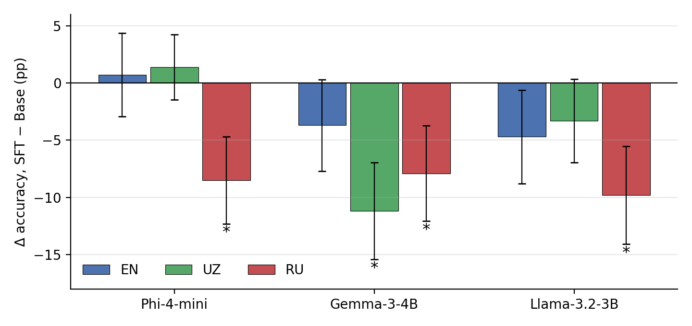

# Cross-Lingual Effects of English-Only Math SFT (EN / UZ / RU)

Experiment artifacts for the paper:

> K. Kurbanov, M. Aripov, *English-Only Supervised Fine-Tuning Does Not Transfer Reliably Across Languages: Evidence from Parallel English, Uzbek and Russian Mathematical Reasoning in Small Language Models*, 2026 (under review).

Three small instruction-tuned models are fine-tuned **only on the English GSM8K training split** and compared before (Base) and after (SFT) fine-tuning on the **same 1,000 GSM8K test problems** presented in parallel English, Uzbek and Russian versions.

## Repository contents

| Path | Description |
|---|---|
| `data/train.jsonl` | English GSM8K train split, 7,473 problems (`question`, `answer`) |
| `data/train_chat.jsonl` | The same 7,473 examples in chat `messages` format (user = question, assistant = solution), used for SFT |
| `data/test_en.jsonl` | 1,000 GSM8K test problems, `random.Random(42).sample(range(1319), 1000)`, original order |
| `data/test_uz.jsonl`, `data/test_ru.jsonl` | Uzbek (Latin script) and Russian translations of the same 1,000 problems, line-aligned with `test_en.jsonl`; identical gold answers |
| `data/test_indices_seed42.json` | Indices of the selected problems in the original 1,319-problem test split |
| `configs/axolotl/*.yaml` | Axolotl SFT configurations for the three models |
| `configs/lm_eval/math_{en,uz,ru}.yaml` | lm-evaluation-harness task definitions |
| `scripts/prepare_dataset.py` | Rebuilds `train*.jsonl` and `test_en.jsonl` from the official GSM8K release |
| `scripts/analyze_results.py` | Computes Δ, 95% CI, Holm-adjusted p-values, transfer gap and retention ratio |
| `results/accuracy.csv`, `results/statistics.csv` | Flexible-extract accuracy and derived statistics |
| `figures/fig1_delta_accuracy.png` | Figure 1 of the paper |
| `paper/` | Manuscript |

## Models

| Model | Base checkpoint | Fine-tuned checkpoint |
|---|---|---|
| Phi-4-mini | `microsoft/Phi-4-mini-instruct` | `kurbanovxurshidbek/phi-4-mini-gsm8k-sft` |
| Gemma-3-4B | `google/gemma-3-4b-it` | `kurbanovxurshidbek/gemma-3-4b-gsm8k-sft` |
| Llama-3.2-3B | `meta-llama/Llama-3.2-3B-Instruct` | `kurbanovxurshidbek/llama-3.2-3b-gsm8k-sft` |

## Training setup

Taken from `configs/axolotl/`:

| Parameter | Value |
|---|---|
| Fine-tuning method | Full-parameter SFT (no LoRA/QLoRA, no 4/8-bit loading) |
| Training data | `data/train_chat.jsonl`, `chat_template` format, loss on assistant turns only |
| Validation split | 1% (`val_set_size: 0.01`) |
| Sequence length | 1,024 tokens, sample packing enabled |
| Micro-batch / gradient accumulation | Phi-4-mini 4 / 4, Gemma-3-4B 4 / 4, Llama-3.2-3B 16 / 1 (16 sequences per device per step) |
| Epochs | 3 |
| Optimizer / scheduler | AdamW (fused) / cosine |
| Learning rate / warm-up / weight decay | 2e-5 / 5% / 0.01 |
| Precision | BF16 (TF32 enabled) |
| Attention | FlashAttention-2 (Phi, Llama), SDPA (Gemma) |
| Gradient checkpointing | Enabled |
| Chat template | Tokenizer default (Phi), `gemma3`, `llama3` |

```bash
axolotl train configs/axolotl/phi-4-mini-sft.yaml
axolotl train configs/axolotl/gemma-3-4b-sft.yaml
axolotl train configs/axolotl/llama-3.2-3b-sft.yaml
```

The configs expect the training file at `/workspace/train_chat.jsonl`. Training was logged to Weights & Biases (project `cross-lingual-math-sft`).

## Evaluation setup

[EleutherAI lm-evaluation-harness](https://github.com/EleutherAI/lm-evaluation-harness) with the custom tasks in `configs/lm_eval/`:

| Setting | Value |
|---|---|
| Tasks | `math_en`, `math_uz`, `math_ru` (1,000 problems each) |
| Prompt | Problem text only, zero-shot |
| Decoding | Greedy (`do_sample: false`), up to 512 new tokens |
| Primary metric | `exact_match`, **flexible-extract** (last number in the output) |
| Secondary metric | `exact_match`, strict-match (`#### N`) |

The task files expect the data at `/workspace/dataset/test_{en,uz,ru}.jsonl`.

```bash
lm_eval --model hf --model_args pretrained=<model>,dtype=bfloat16 \
  --include_path configs/lm_eval --tasks math_en,math_uz,math_ru --log_samples --output_path eval_results/<model>
```

## Main results

Flexible-extract accuracy (%), 1,000 problems per language. * Holm-adjusted p < 0.05 (nine comparisons).

| Model | EN Base → SFT | UZ Base → SFT | RU Base → SFT |
|---|---|---|---|
| Phi-4-mini | 77.4 → 78.1 (+0.7) | 11.3 → 12.7 (+1.4) | 78.7 → 70.2 (**−8.5***) |
| Gemma-3-4B | 72.0 → 68.3 (−3.7) | 44.1 → 32.9 (**−11.2***) | 68.9 → 61.0 (**−7.9***) |
| Llama-3.2-3B | 70.4 → 65.7 (−4.7) | 24.1 → 20.8 (−3.3) | 64.5 → 54.7 (**−9.8***) |

No comparison improves significantly. Russian declines for all three models and declines more than English in every case; the Russian-to-English accuracy ratio falls from 0.92–1.02 (Base) to 0.83–0.90 (SFT).



```bash
python scripts/analyze_results.py   # -> results/statistics.csv
```

## Notes

- The p-values use an unpaired two-proportion z-test, which is conservative for this paired design; per-problem outputs allow a McNemar test.
- The flexible-extract regex does not handle space-separated thousands (e.g. `1 000`); this can affect Russian-language outputs.
- Uzbek and Russian problems preserve all quantities of the English originals; a few items differ only in surface form (e.g. 24-hour time, fractions written as words).

## License

Code and configurations: MIT. GSM8K data: MIT, © 2021 OpenAI (`openai/grade-school-math`).
